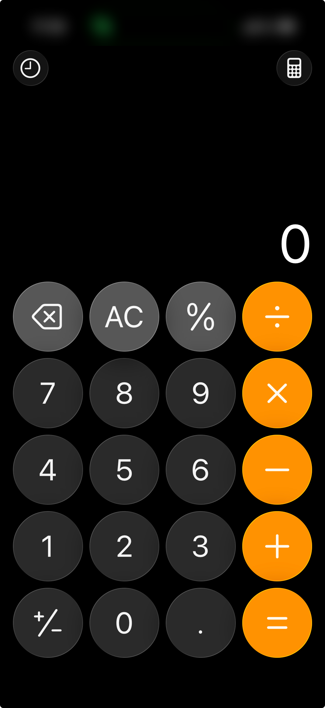

# 画面遷移
- 

# 必要な機能の洗い出し(11/1-17:20)
- 誰が: 顧客
- 何を: 数式を計算
- どのように: 数式を入力
- 入力: 数値、演算子、「=」
- 出力: 計算結果
- ゴール: 2 つの数値と 1 つの演算子を使用して計算

# ボタン(11/1-18:00)
- NumberButton: 濃い灰色
  - 数字: 0~9
  - 小数点: 「.」
- FunctionButton: 薄い灰色
  - 符号切替: 「+/-」
  - Delete: 「x」
  - Clear: 「AC」/「C」
- OperatorButton: オレンジ色
  - 演算子: 「＋」「ー」「×」「÷」
  - 等号: 「＝」

# ディスプレイ(11/3-19:00)
- Display: 表示部
  - Expression: 計算式
  - Value: 値

# Claude + Figmaデザイン実装(11/1-18:00)
## 1. カラー登録（Variables）
- 画像のピクセルから色を抽出（Display P3 → sRGB に変換）
- `Primitives`: 色の実値（`black` `white` `gray/400〜950` `orange/300・500`）
- `Color`: 用途別に Primitives を参照
  - 背景: `color/bg/app`
  - ボタン: `color/button/{number,function,operator}/{bg,border}`
  - 文字: `color/text/{primary,secondary}`
- `Colors` フレームに全色のスウォッチを配置

## 2. ボタン（Components）
- `Buttons` フレームにマスターを 1 つずつ配置
  - `NumberButton`（0）/ `FunctionButton`（AC）/ `OperatorButton`（+）
- 86×86 の円、色はすべて Variables に紐付け
- `Label` プロパティでラベルを切替

## 3. 画面
| フレーム | 元画像 | 表示 | AC/C |
|---|---|---|---|
| `Calculator` | 電卓画像.png | 0 | AC |
| `CalculatorResult` | 電卓計算結果.png | 12+5 → 17 | AC |
| `CalculatorTyping` | 電卓入力中.png | 1 | C |

```
Calculator（384×835）
├── Display … 残りの高さを使い、右下揃え
│   ├── Expression（計算式・グレー／不要時は非表示）
│   └── Value（値・白）
└── Keypad … 5行×4列、ボタンのインスタンス（82×82）
```

## 4. ルール
- 新しい色は Variables に登録してから使う
- Display は `Expression` + `Value` の 2 段構成で統一
- ボタンはインスタンスの `Label` を書き換えて使う

## 5. 注意点
- フォントは Inter（SF Pro は Figma の API で文字幅を計算できなかった）
- 演算子は文字のため、画像のアイコンより細く小さい
- 上部の時計・計算機アイコンとステータスバーは対象外

# デザインについて(11/14-15:40)
- Figma で作成したデザインから Dev Mode で CSS をとりたい
  - Dev Mode は有料プランでないとダメ
  - Figma MCP からとってくるのが無難
- とってきた CSS を使用して、将来的に Nuxt で画面を実装する
- Nuxt UI を使用する予定
  - Tailwind CSS ベース、TS 対応、キーボードアクセシビリティ対応

## Nuxt UI の導入
- ``@nuxt/ui``, ``tailwindcss`` をインストールする
  ```sh
  npm install @nuxt/ui tailwindcss
  ```
- [Nuxt UI について](https://zenn.dev/1stscratch/articles/b387b71cb23255)
- ``nuxt.config.ts`` にインストールしたパッケージを追加
  ```ts
  modules: ['@nuxt/ui'],
  css: ['~/assets/css/main.css'],
  ```
- ``app/app.vue`` の全体を ``<UApp>`` で囲む(div タグを置き換える)
  - トーストやモーダルなどの動作に必要

# 計画(11/3-18:30)
## プロトタイプ
- ボタンを押した時に、押したボタンの内容を Value に表示させる

### 色の登録
- Nuxt UI をインストールしたので、 ``main.cs`` に import 文を書く
  ```css
  @import "tailwindcss";
  @import "@nuxt/ui";
  ```
- 「@theme static」に Figma で使用した色を登録する。
  - Figma で登録した名前をハイフン区切りで命名
    ```css
    --color-button-number-bg: #2a2a2a;
    ```

### フォントの登録
- ``main.cs`` の ``@theme`` に追加
  ```css
  --font-sans: "Inter", sans-serif;
  ```

### ボタンコンポーネントの作成(11/14-16:30)
- コンポーネント: ``components/CalculatorButton.vue``
- Figma 上の ``NumberButton``, ``FunctionButton``, ``OperatorButton`` を 1 つにまとめる
  - 違うのは色だけ
  - kind: ボタンの種類を指定
  - label: ボタンの中身を指定
- Figma で実装したボタンの UI を claude code に書かせる
  - kindClass という辞書を作成
    - ボタンの種類をキーとして、背景色とボーダーの色を値として設定
    - この辞書を UButton タグの class 属性で呼び出すことで、ボタンの種類ごとに背景色とボーダーの色を設定

